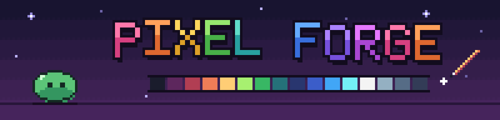
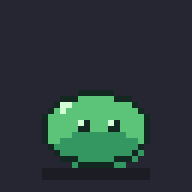
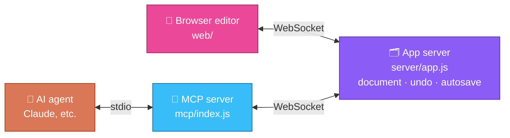

<p align="center">
  
</p>

<h3 align="center">A pixel-art sprite animator that runs in your browser —<br>with an AI co-pilot that draws alongside you, live.</h3>

<p align="center">
  <a href="LICENSE"></a>
  <a href="https://nodejs.org"></a>
  <a href="https://modelcontextprotocol.io"></a>
  <a href="https://claude.com/claude-code"></a>
  <br>
  
  
  <a href="https://github.com/dewayneku/pixel-forge/stargazers"></a>
  <a href="https://ko-fi.com/T5Y42AGW58"></a>
</p>

<p align="center">
  <a href="#-quick-start"><b>Quick start</b></a> ·
  <a href="#-features"><b>Features</b></a> ·
  <a href="#-draw-with-an-ai-agent"><b>AI agent</b></a> ·
  <a href="#-importing-images"><b>Import</b></a> ·
  <a href="#-exporting"><b>Export</b></a> ·
  <a href="#-game-boy-style"><b>Game Boy style</b></a> ·
  <a href="#%EF%B8%8F-shortcuts"><b>Shortcuts</b></a> ·
  <a href="#-support"><b>Support</b></a>
</p>

<p align="center">
  
</p>

Draw, animate and export sprites in a lightweight editor. Connect an AI agent like
[Claude](https://claude.com/claude-code) through the built-in [MCP](https://modelcontextprotocol.io)
server and it sees the same canvas you do: ask it to add an idle animation, clean up a sprite
sheet or put a hat on a new layer, and watch the edits land on your screen as it makes them.

## ✨ Features

<table>
  <tr>
    <td width="33%" valign="top">
      <h3>🎨 Draw</h3>
      Pencil, eraser, fill, eyedropper, line, rectangle and ellipse. Layers with opacity, a
      palette, shared undo/redo, smooth zoom and pan.
    </td>
    <td width="33%" valign="top">
      <h3>🎞️ Animate</h3>
      Timeline with per-frame timing, onion skin and live playback on the canvas and in a
      preview window.
    </td>
    <td width="33%" valign="top">
      <h3>🤖 Collaborate</h3>
      23 MCP tools let an AI agent see your sprite, read exact pixels, draw, animate and point
      at things on your screen, live.
    </td>
  </tr>
  <tr>
    <td valign="top">
      <h3>📥 Import anything</h3>
      PNG, GIF, JPEG, WebP, BMP. Cut sheets by grid or <b>auto-detect every sprite</b> on a
      messy sheet, remove backgrounds, clean up JPEG noise.
    </td>
    <td valign="top">
      <h3>📤 Export</h3>
      PNG frames, sprite sheets with a JSON of frame positions and timings, and looping
      <b>animated GIFs</b>.
    </td>
    <td valign="top">
      <h3>⚡ Zero fuss</h3>
      No build step, no account, runs on your machine. Your work autosaves and comes back when
      you restart.
    </td>
  </tr>
</table>

## 🚀 Quick start

You need [Node.js](https://nodejs.org) 18 or newer.

```bash
git clone https://github.com/dewayneku/pixel-forge.git
cd pixel-forge
npm install
npm start
```

Then open **http://localhost:7777** and start drawing.

> [!TIP]
> Your work autosaves to `data/autosave.forge.json`. Use **Save** to keep a project as a
> `.forge.json` file you can open again or share.

## 🤖 Draw with an AI agent

**Claude Code**: this repo includes a `.mcp.json`, so starting Claude Code in the `pixel-forge`
folder offers the `pixel-forge` server. Approve it, or add it from anywhere:

```bash
claude mcp add pixel-forge -- node /path/to/pixel-forge/mcp/index.js
```

**Claude Desktop and other MCP clients**: add this to the client's MCP config, with the full
path to your copy:

```json
{
  "mcpServers": {
    "pixel-forge": { "command": "node", "args": ["/path/to/pixel-forge/mcp/index.js"] }
  }
}
```

Then just ask:

> 💬 *"Look at what I'm drawing and suggest shading."*<br>
> 💬 *"Add a 4-frame idle bob animation to this sprite."*<br>
> 💬 *"Import this sprite sheet, pick the walk cycle and clean up the colors."*<br>
> 💬 *"Put a hat on a new layer."*

If the editor isn't running, the MCP server starts it automatically. The agent's edits appear
instantly with a pop-up, an entry in the activity feed, and an orange box when it points at
something. Undo is shared, so <kbd>Ctrl</kbd>+<kbd>Z</kbd> also undoes the agent's last change.
When it leaves out a frame or layer, it uses the one you have selected.

<details>
<summary><b>🧰 All 23 tools the agent gets</b></summary>
<br>

| Tool | What it does |
| --- | --- |
| `get_document` | Size, frames, layers, palette, and what you have selected |
| `view_frame`, `view_animation` | See a frame, or all frames as a sheet, as an image |
| `get_pixels` / `draw_grid` | Read or write pixels as a character grid with a color legend |
| `set_pixels`, `draw_shape`, `fill` | Pixels, lines, rectangles, ellipses, paint bucket |
| `edit_cel` | Clear, shift, flip, copy from another frame, replace a color |
| `manage_frames`, `manage_layers` | Add, duplicate, delete, reorder, timing, visibility |
| `reduce_colors` | Clean up colors: reduce to N colors or snap to the palette, remove stray pixels |
| `set_palette`, `canvas`, `history` | Palette, new/resize canvas, undo/redo |
| `annotate` | Highlight a region on your screen with a message |
| `get_activity` | What you (and the agent) changed recently |
| `analyze_image` | See an image file with every sprite boxed and numbered |
| `import_image` | Import a PNG/JPEG as a new sprite, frames or a layer; remove backgrounds; cut by grid or by detected sprites |
| `gameboy_style` | Convert a sprite to the Game Boy (Gen 1 / Gen 2) style |
| `style_check` | Score a sprite against the measured Gen 1 / Gen 2 style, with advice |
| `file`, `open_editor` | Save/open projects, export a PNG frame, sprite sheet or looping animated GIF, open the editor |

</details>

## 📥 Importing images

Click **Import** or drop an image on the window (PNG, GIF, JPEG, WebP or BMP; a dropped
`.forge.json` opens as a project). The dialog previews exactly what you'll get:

- 🧽 **Remove background**: makes a solid background transparent. The color is detected from
  the image border; raise **Tolerance** for noisy JPEGs. "Keep matching colors inside sprites"
  only removes background touching the edge, so white eyes and highlights survive.
- 🔲 **Cut into → Even grid**: fixed frame size, spacing and margin. Strips of square frames
  are detected automatically.
- 🔍 **Cut into → Separate sprites**: finds every sprite on a messy sheet. Click sprites to pick
  them in the order you want as frames, or import them all. Frames are sized to the largest
  pick and sprites line up by their feet so animations don't jitter. Raise **Join gap** if
  detached parts (a sword, an effect) come out as separate sprites.
- 🎨 **Clean up colors**: JPEGs and resized art smear pixel art into hundreds of near-identical
  shades. This pulls the frames back to a small palette (24 colors by default, on automatically
  for JPEGs), makes edges fully opaque or transparent, and removes stray single pixels. The
  colors become your palette, or snap to your current palette instead.
- ➕ **Import as** a new sprite, new frames after the current one, or a new layer.

To clean up a sprite that's already in the editor, use **Reduce…** above the palette: type a
number of colors, or "palette" to snap to the current one. Undo brings the original back.

## 📤 Exporting

Pick a scale in the top bar, then:

| Button | You get |
| --- | --- |
| **Frame PNG** | The current frame |
| **Sprite sheet** | All frames in a PNG, plus a JSON of frame positions and durations |
| **GIF** | An animated GIF that loops forever, with each frame's own timing |

GIFs keep transparency (fully on or off) and up to 255 colors. GIF timing is in 10 ms steps, so
frames shorter than 20 ms play slower in most viewers.

## 🎮 Game Boy style

Turn a modern monster sprite into the look of the original Game Boy games: 4 shades, a 40, 48 or
56 px canvas, a bold black outline and heavy interior lines. Click **GB style** in the top bar,
or ask your agent to use `gameboy_style`.

- **Two presets**: `gen1` is rougher and moodier (broken outlines, more dark shading, more
  texture); `gen2` is cleaner and lighter (an almost solid outline, bigger flat areas).
- **Tone**: `lighter`, `darker` or `darkest` for creatures whose character the numbers can't
  guess, like a ghost that should be mostly black.
- **Colors**: the original 4 grays, or two Game Boy Color tints picked from the source.
- **Measured, not guessed**: the targets come from measuring hundreds of real Game Boy-era
  sprites (shade balance, outline coverage, interior lines, canvas use, noise).
  `style_check` scores any sprite against them; each check passes in the range ~90% of real
  sprites fall in.

> [!IMPORTANT]
> The converter does the mechanical part. Faces, eyes and clean spike tips still need a hand
> pass — that's what the bundled Claude skill
> ([`.claude/skills/gameboy-sprite-style`](.claude/skills/gameboy-sprite-style/SKILL.md)) walks
> the agent through, checking its work with `style_check` as it goes.

## ⌨️ Shortcuts

<details>
<summary><b>Show all editor shortcuts</b></summary>
<br>

| Key | Action |
| --- | --- |
| <kbd>B</kbd> <kbd>E</kbd> <kbd>G</kbd> <kbd>I</kbd> | Pencil / eraser / fill / eyedropper |
| <kbd>L</kbd> <kbd>U</kbd> <kbd>O</kbd> | Line / rectangle / ellipse |
| <kbd>H</kbd> or hold <kbd>Space</kbd> | Pan (middle mouse also pans) |
| Right-click | Erase · <kbd>Alt</kbd>+click picks a color · <kbd>Shift</kbd>+fill replaces a color everywhere |
| <kbd>[</kbd> <kbd>]</kbd> | Brush size |
| <kbd>,</kbd> <kbd>.</kbd> (or <kbd>←</kbd> <kbd>→</kbd>) | Previous / next frame |
| <kbd>Enter</kbd> | Play / pause |
| <kbd>Ctrl</kbd>+<kbd>Z</kbd> / <kbd>Ctrl</kbd>+<kbd>Y</kbd> | Undo / redo |
| <kbd>Ctrl</kbd>+<kbd>S</kbd> | Save project file |
| <kbd>0</kbd> | Fit to screen |
| Mouse wheel | Zoom |

</details>

## 🧩 How it works



<details>
<summary><b>📁 Project layout</b></summary>
<br>

- `server/doc.js`: document model (layers, frames, cels as RGBA)
- `server/methods.js`: every edit operation, shared by the editor and the MCP server
- `server/png.js`, `server/gif.js`: PNG and animated GIF encoding
- `web/`: the editor (plain JS, no build step)
- `web/imagetools.js`: background removal, sprite detection and color cleanup (shared by editor and server)
- `web/gbstyle.js`: the Game Boy style converter and scorer (shared by editor and server)
- `.claude/skills/gameboy-sprite-style/`: the Claude skill for converting and hand-finishing
- `mcp/index.js`: the MCP tools, forwarding to the app server
- `scripts/`: end-to-end tests, plus the scripts that draw this README's banner and demo

Set `PIXEL_FORGE_PORT` to use a port other than 7777.

</details>

## 🤝 Contributing

Issues and pull requests are welcome! The code is plain JavaScript with no build step. The
end-to-end scripts in `scripts/` drive the MCP server like an agent would. They **replace the
open sprite**, so run them against a separate port (each port keeps its own autosave):

```bash
PIXEL_FORGE_PORT=7790 npm start    # terminal 1
PIXEL_FORGE_PORT=7790 npm test     # terminal 2
```

On Windows PowerShell, set the port first with `$env:PIXEL_FORGE_PORT=7790`.

> [!NOTE]
> Please don't commit sprites or sheets you don't have the rights to share. `projects/` and
> `data/` are git-ignored for your own work.

## 💖 Support

Pixel Forge is free and open source. If it helps you and you'd like to chip in, you can buy me a
coffee — every bit helps keep it going. ☕

<p align="center">
  <a href="https://ko-fi.com/T5Y42AGW58"></a>
</p>

Starring the repo ⭐, sharing what you make with it, and reporting bugs help a lot too.

## 📜 License

[MIT](LICENSE) © dewayneku
